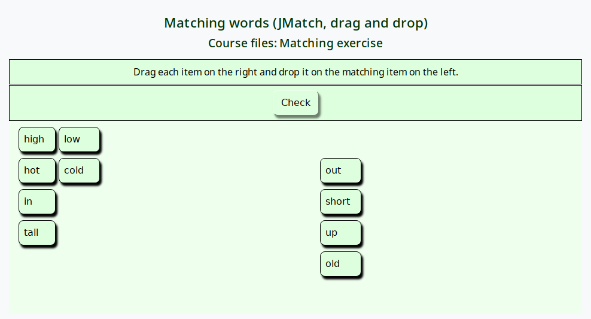
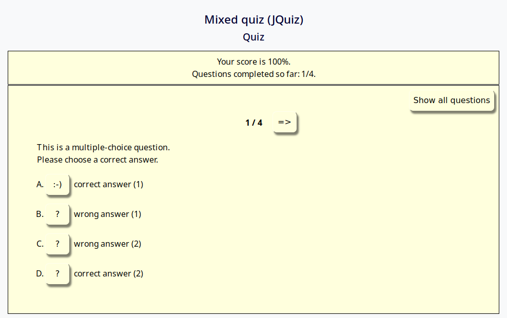
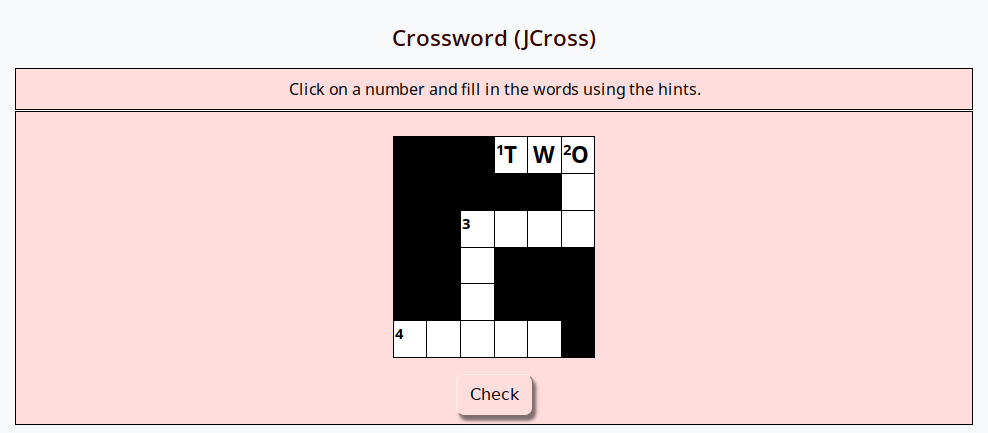
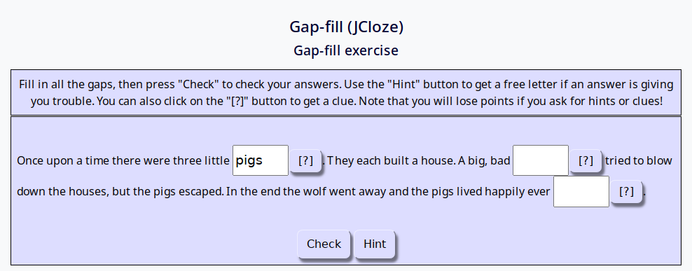
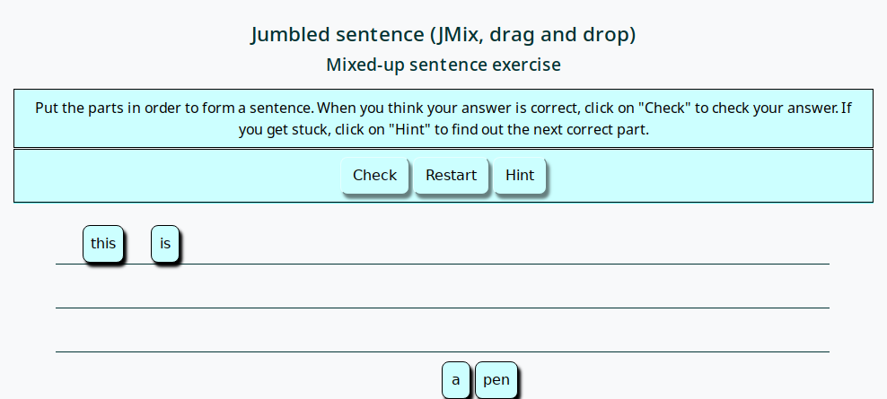
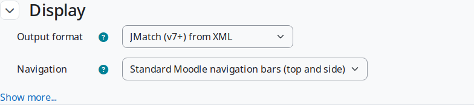
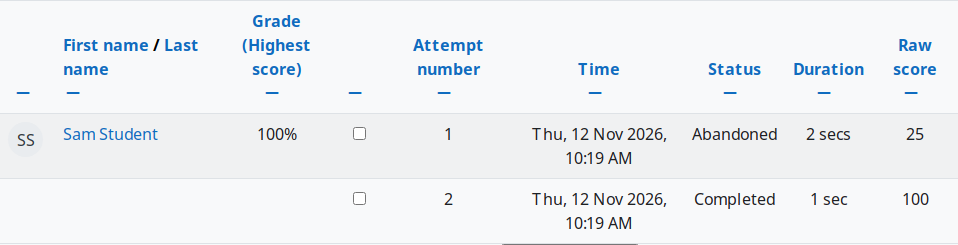

# HotPot activity module for Moodle


HotPot lets teachers use **Hot Potatoes** and other externally authored interactive
exercises as Moodle activities. Students' scores are saved to the Moodle gradebook,
and teachers can review every attempt and response in HotPot's reports.

## Features

- Upload a Hot Potatoes 6 or 7 **data file** (`.jqz`, `.jcl`, `.jcw`, `.jmt`, `.jmx`)
  or an **exported web page** (`.htm`, `.html`); HotPot detects the type of file.
- Choose how each exercise is displayed, including the original HP6 and HP7 layouts,
  drag-and-drop and flashcard versions.
- Scores are sent to the Moodle gradebook, using the highest, average, first or last attempt.
- Control access with open and close dates, time limits, attempt limits,
  passwords and IP address restrictions.
- Optional entry and exit pages, and options for students to review their attempts.
- Reports for teachers: overview, scores, responses, item analysis and click trail.
- Activity completion conditions: minimum grade, passing grade, or "completed" status.
- Backup and restore, and support for Moodle's privacy API.

## Supported exercise types

| Software | Exercise types |
|---|---|
| Hot Potatoes 6 and 7 | JQuiz, JCloze, JCross, JMatch (standard, drag-and-drop and flashcard), JMix (standard and drag-and-drop) |
| Hot Potatoes add-ons | DropDown, JGloss and JMemori (by Michael Rottmeier), JMatch Intro, JMatch Sort, auto-advance JCloze and JQuiz, JQuiz exam, JMix deluxe and keypress, ANCT-Scan |
| TexToys | Rhubarb and Sequitur |
| Other | Xerte, iSpring and Qedoc |

## Screenshots

Click on a screenshot to see it full size.

| JMatch (drag and drop) | JQuiz | JCross |
|:---:|:---:|:---:|
| <a href="pix/screenshots/jmatch-drag.png"></a> | <a href="pix/screenshots/jquiz.png"></a> | <a href="pix/screenshots/jcross.png"></a> |
| **JCloze** | **JMix (drag and drop)** | |
| <a href="pix/screenshots/jcloze.png"></a> | <a href="pix/screenshots/jmix-drag.png"></a> | |

| Activity settings: choose how the exercise is displayed | Overview report: every attempt, with its status and score |
|:---:|:---:|
| <a href="pix/screenshots/settings.png"></a> | <a href="pix/screenshots/report.png"></a> |

## Requirements

- Moodle 2.0 or later. The current version has been tested on Moodle 5.3 with PHP 8.3,
  and the code is written to remain compatible with older versions of Moodle and PHP.
- To create exercises, you need [Hot Potatoes](https://hotpot.uvic.ca/), which is free.
  Hot Potatoes 6 is no longer available from its authors, but HotPot still plays
  exercises created with it.

## Installation

1. Get the plugin, using any one of these methods:
   - **Moodle plugins directory:** download the zip file from
     [moodle.org/plugins/mod_hotpot](https://moodle.org/plugins/mod_hotpot),
     or install it from within Moodle via *Site administration > Plugins > Install plugins*.
   - **GitHub:** download the zip file from
     [github.com/gbateson/moodle-mod_hotpot](https://github.com/gbateson/moodle-mod_hotpot)
     (*Code > Download ZIP*), or clone the repository:
     ```
     git clone https://github.com/gbateson/moodle-mod_hotpot.git mod/hotpot
     ```
2. If you downloaded a zip file, unzip it and rename the folder to `hotpot`.
   Put this folder in the `mod` folder of your Moodle site, so that it is at `mod/hotpot`
   (not `mod/hotpot/hotpot`).
   - In Moodle 5.1 and later, the `mod` folder is inside the `public` folder,
     so the plugin goes in `public/mod/hotpot`.
3. Log in to Moodle as an administrator and go to *Site administration > Notifications*
   to complete the installation.

## Adding a HotPot activity to a course

1. On your course page, turn on *Edit mode* and choose *Add an activity or resource > HotPot*.
2. Under *Source file*, upload your Hot Potatoes file. Also upload any images or
   sound files that the exercise uses.
3. If you wish, change the *Output format* in the *Display* section,
   and review the other settings.
4. Click *Save and display*.

## Related plugins

- **HotPot question import:** imports Hot Potatoes exercises into the Moodle question bank
  ([moodle.org](https://moodle.org/plugins/qformat_hotpot),
  [GitHub](https://github.com/gbateson/moodle-qformat_hotpot)).
- **TaskChain:** combines several HotPot-style tasks into a chain, with conditions
  for moving from one task to the next
  ([moodle.org](https://moodle.org/plugins/mod_taskchain),
  [GitHub](https://github.com/gbateson/moodle-mod_taskchain)).

## Support and contributing

Please report problems and suggestions on the
[GitHub issue tracker](https://github.com/gbateson/moodle-mod_hotpot/issues).
Pull requests are welcome.

## Changes

See [CHANGES.txt](CHANGES.txt) for the history of changes to this plugin.

## Support HotPot

HotPot is free, and always will be. If you find it useful, you can help to keep it
up to date with new versions of Moodle and Hot Potatoes by
[sponsoring its development on GitHub](https://github.com/sponsors/gbateson).

## Credits

HotPot was written by Gordon Bateson. Thanks to everyone who has reported issues
and sent pull requests, and to the sponsors who have generously contributed
to its development:

- Agencia de Gestio d'Ajuts Universitaris i de Recerca (AGAUR),
  Autonomous Government of Catalonia, Spain (via Josep M. Fontana, Universitat Pompeu Fabra)
- Rikkyo University, Japan (via Paul Allum)
- Universite de Franche-Comte, France (via Glenys Hanson)
- Akashi National Technical College, Japan (via John Herbert)
- Moodle HQ

## License

HotPot is free software, distributed under the terms of the
[GNU General Public License](https://www.gnu.org/licenses/gpl-3.0.html), version 3 or later.
It is provided "as is", without warranty of any kind.
